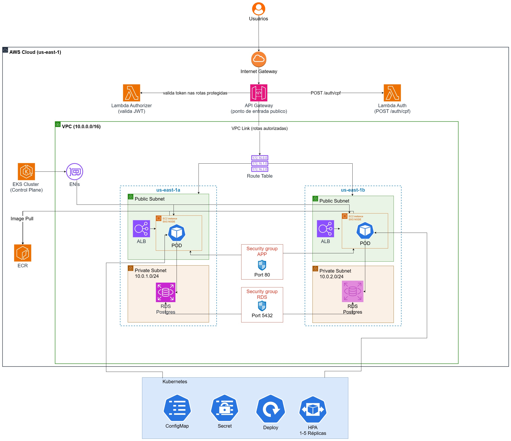
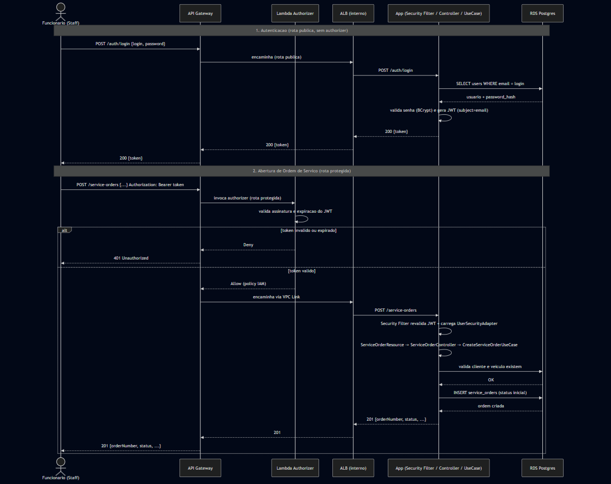
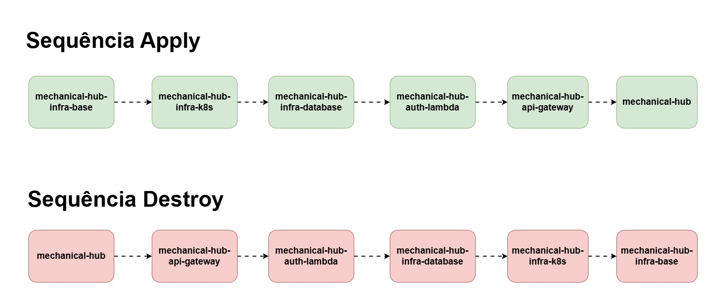

# mechanical-hub-api-gateway

Ponto de entrada público do projeto mechanical-hub: o HTTP API Gateway, o ALB
interno + target group que encaminha para os nodes do EKS, o VPC Link que liga
os dois, e a Lambda Authorizer que valida o JWT nas rotas protegidas.

## Tecnologias

- **Terraform** (`hashicorp/aws ~> 5.0`) — API Gateway (HTTP API v2), ALB, target group, VPC Link, Lambda Authorizer.
- **AWS API Gateway (HTTP API)** — roteamento público, autorização via Lambda `REQUEST`.
- **AWS ALB** — interno, não exposto à internet.
- **Python 3.12 + PyJWT** — código do Lambda Authorizer.
- **GitHub Actions** — instala as dependências Python, empacota e aplica/destrói via Terraform.

## Diagrama de arquitetura



### Autenticação e abertura de Ordem de Serviço

Mostra dois momentos: (1) o login do funcionário via `POST /auth/login`, rota
pública que não passa pelo authorizer; e (2) a abertura de uma ordem de serviço,
rota protegida — o API Gateway invoca a Lambda Authorizer, que valida a
assinatura e expiração do JWT e responde Allow/Deny; se autorizado, o pedido segue
via VPC Link até o ALB interno e chega na aplicação, onde o Security Filter
revalida o JWT antes de criar a ordem de serviço e devolver a resposta.



## Passos para execução e deploy

**É o último repositório de infraestrutura a ser aplicado** — depende de todos os
outros: `infra-base` (VPC, subnets privadas, SG do ALB), `infra-k8s` (cluster EKS e
node group, para o `aws_autoscaling_attachment` do target group) e `auth-lambda`
(ARN da Lambda, para a rota `POST /auth/cpf`). Ordem completa: infra-base →
infra-k8s → infra-database → auth-lambda → **api-gateway** → `mechanical-hub`
(app). Para derrubar, é o **primeiro** a sair.



1. Configurar no repositório os secrets `AWS_ACCESS_KEY_ID`, `AWS_SECRET_ACCESS_KEY`,
   `AWS_SESSION_TOKEN`, `AWS_ACCOUNT_ID` e `JWT_SECRET` (mesmo valor do repo
   `mechanical-hub` e do `auth-lambda`).
2. Garantir que `infra-base`, `infra-k8s`, `infra-database` e `auth-lambda` já
   foram aplicados.
3. No início da sessão do AWS Academy, garantir `infra/pipeline.conf` com
   `DESTROY=false` e fazer merge em `main` via PR (branch protegida, sem push
   direto), ou disparar `workflow_dispatch` manualmente.
4. A pipeline instala as dependências Python do authorizer, empacota o zip via
   Terraform e aplica API Gateway, ALB, VPC Link e Lambda Authorizer.
5. Conferir o output `api_endpoint` — é a URL pública real da aplicação inteira.
6. Antes da sessão do AWS Academy encerrar, mudar `infra/pipeline.conf` para
   `DESTROY=true` e fazer merge em `main` via PR.

## Decisões arquiteturais relacionadas

RFCs e ADRs ficam centralizados no repo da aplicação, para não duplicar/desincronizar entre os 6 repositórios. As diretamente relevantes para este repo:

- [RFC-003 — Estratégia de autenticação: dois fluxos coexistindo](https://github.com/estefanyneres/mechanical-hub/blob/main/src/docs/fase3/documentacao/rfcs.md)
- [RFC-004 — Lambda authorizer validando na borda, mantendo Spring Security como defesa em profundidade](https://github.com/estefanyneres/mechanical-hub/blob/main/src/docs/fase3/documentacao/rfcs.md)
- [ADR-002 — Descoberta entre repositórios via data source](https://github.com/estefanyneres/mechanical-hub/blob/main/src/docs/fase3/documentacao/adrs.md)
- [ADR-004 — ALB criado pelo Terraform, Service como NodePort](https://github.com/estefanyneres/mechanical-hub/blob/main/src/docs/fase3/documentacao/adrs.md)

## Rotas e o Lambda Authorizer

A rota curinga `ANY /{proxy+}` (todo o resto do tráfego pra aplicação) fica
protegida pelo authorizer (`authorization_type = "CUSTOM"`), controlável por
`enable_authorizer` (útil para testar roteamento sem JWT). Ficam **fora** do
authorizer, deliberadamente: `POST /auth/login`, `GET /actuator/health`,
Swagger/OpenAPI, e `POST /auth/cpf` (que é integrada direto com a Lambda de
autenticação, `AWS_PROXY`, não com o ALB).

O authorizer é um `REQUEST` authorizer com `enable_simple_responses = true` — só
decodifica e valida o JWT (assinatura, emissor, expiração) usando o mesmo
`JWT_SECRET` da aplicação e da `auth-lambda`; não decide autorização por papel,
isso continua sendo responsabilidade do Spring Security dentro da aplicação
(RFC-004).

## Outputs publicados

| Output                    | Descrição                              |
|-----------------------------|-------------------------------------------|
| `api_endpoint`              | URL pública do HTTP API                  |
| `alb_dns_name`              | DNS interno do ALB                       |
| `authorizer_function_name`  | Nome da função Lambda do authorizer      |

## Pipelines

- `pipeline-infra-feature.yml`: dispara em push para `feature/*`. Roda
  `terraform fmt -check`, `init -backend=false` e `validate`. Abre PR automático
  para `main` se tudo passar.
- `pipeline-infra-main.yml`: dispara em push para `main` (ou `workflow_dispatch`).
  Instala as dependências Python do authorizer, lê `infra/pipeline.conf` e aplica
  ou destrói o Terraform conforme `DESTROY`, passando `aws_account_id` e
  `jwt_secret` via `-var`.

## Estrutura

```
mechanical-hub-api-gateway/
├── .github/workflows/
│   ├── pipeline-infra-feature.yml
│   └── pipeline-infra-main.yml
├── docs/
│   └── desenhos/
│       ├── mechanical-hub-infraestrutura-fase-03.jpg
│       ├── mechanical-hub-apply-destroy-repos-fase-03.jpg
│       └── sequencia-auth-abertura-os-fase-03.png
├── infra/
│   ├── providers.tf
│   ├── variables.tf
│   ├── data.tf
│   ├── http_api.tf
│   ├── alb.tf
│   ├── vpc_link.tf
│   ├── authorizer.tf
│   ├── outputs.tf
│   └── pipeline.conf
├── src/
│   ├── authorizer.py
│   └── requirements.txt
├── .gitignore
└── README.md
```

